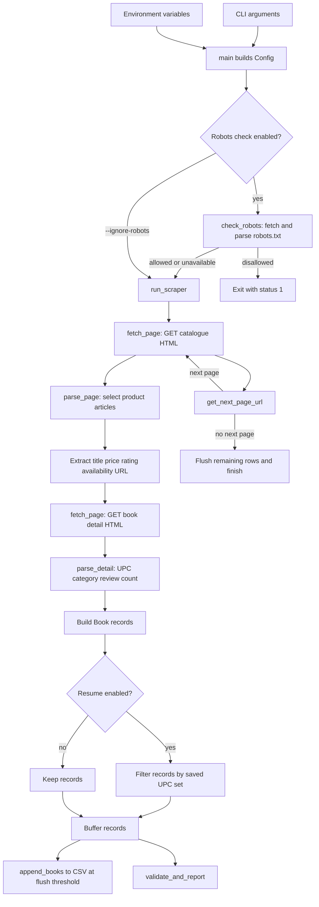

# Technical Documentation

This reference describes the implementation in this repository. Statements about behavior refer to code or checked-in data; unavailable details are labeled **Not determined from code**.

## Table of Contents

- [Project Overview](#project-overview)
- [Tech Stack Summary](#tech-stack-summary)
- [Project Structure](#project-structure)
- [Architecture and Working](#architecture-and-working)
- [Data Flow Diagram](#data-flow-diagram)
- [Libraries and Dependencies](#libraries-and-dependencies)
- [APIs](#apis)
- [Database Design](#database-design)
- [Output Dataset Schema](#output-dataset-schema)
- [Configuration and Environment](#configuration-and-environment)
- [Setup and Installation](#setup-and-installation)
- [Scraping Logic](#scraping-logic)
- [Authentication and Security](#authentication-and-security)
- [Error Handling and Logging](#error-handling-and-logging)
- [Testing](#testing)
- [Ethical Scraping Notes](#ethical-scraping-notes)
- [How to Extend](#how-to-extend)
- [Known Issues and Limitations](#known-issues-and-limitations)
- [Assumptions and Analysis Limits](#assumptions-and-analysis-limits)

## Project Overview

The project is a Python command-line scraper for the Books to Scrape practice catalogue. It follows catalogue pagination, extracts listing information, visits individual book pages for UPC/category/review count, and writes rows to a CSV file (scraper.py: Config, parse_page, parse_detail, run_scraper; README.md: Goal).

Its stated context is the CodeAlpha Data Analytics Internship; its output is intended for analysis. A more specific target user role is **Not determined from code** (README.md: Goal; scraper.py: Book).

Implemented options include output path, page limit, delay, UPC-based resume, and one-page dry-run (scraper.py: build_arg_parser, main). Records are buffered and appended, and a validation summary is logged (scraper.py: run_scraper, validate_and_report).

## Tech Stack Summary

| Area | Technology | Evidence |
|---|---|---|
| Language/runtime | Python; README states Python 3.10+ | scraper.py; README.md: Prerequisites |
| HTTP | requests Session | scraper.py: fetch_page, run_scraper |
| HTML parsing | Beautiful Soup 4 with html.parser | scraper.py: fetch_page |
| Output | UTF-8 CSV via standard library csv | scraper.py: init_csv, append_books |
| CLI/configuration | argparse, dataclasses, environment variables | scraper.py: Config, build_arg_parser, main |
| Database | None; records persist in CSV | scraper.py: Book, append_books |
| Frontend | None found | Repository structure |
| Test tooling | pytest and unittest.mock | requirements.txt; test_scraper.py |
| Execution | Local command-line process | scraper.py: main |

## Project Structure

    .
    ├── scraper.py                 # Configuration, HTTP, parsing, CSV output, CLI
    ├── test_scraper.py            # Unit tests using fixtures and mocks
    ├── requirements.txt           # Pinned third-party packages
    ├── README.md                  # Project summary, setup, usage, and design notes
    ├── books_dataset.csv          # Checked-in CSV sample/output
    ├── fixtures/
    │   ├── listing_page.html      # Catalogue listing fixture with a next link
    │   ├── last_page.html         # Listing fixture without next link
    │   └── detail_page.html       # Book detail fixture
    ├── docs/
    │   └── TECHNICAL_DOCUMENTATION.md # This document
    └── .gitignore                 # Ignore patterns for caches, virtual environments, and builds

No package.json, pyproject.toml, web templates, database migrations, or server entry point is present in the repository file listing.

## Architecture and Working

This is a single-process CLI with an outbound HTTP client. main() parses arguments and updates Config. run_scraper() creates the Session and iterates listing URLs. Each listing page is parsed into Book records; for each article, parse_page() makes a detail request and parse_detail() supplies supplementary values. run_scraper() appends buffered records to CSV and follows the next catalogue link (scraper.py: main, Config, run_scraper, parse_page, parse_detail, get_next_page_url, append_books).

The code has no project-owned web endpoints, frontend, or database. External integration is limited to HTTP requests to Books to Scrape (scraper.py: fetch_page).

## Data Flow Diagram

Resume filtering occurs after parse_page() has already made detail requests for each listing record. Validation runs on current-run records after the final flush (scraper.py: run_scraper, parse_page, validate_and_report).

## Libraries and Dependencies

### Backend/runtime packages

| Name | Version | Purpose | Project use |
|---|---:|---|---|
| requests | 2.32.3 | HTTP requests, Session, HTTP errors | scraper.py; requirements.txt |
| beautifulsoup4 | 4.12.3 | HTML parsing | scraper.py; requirements.txt |

### Frontend packages

None. No frontend files or CDN scripts were found.

### Development/test packages

| Name | Version | Purpose | Project use |
|---|---:|---|---|
| pytest | 8.3.5 | Test runner | test_scraper.py; requirements.txt |

### Project snippets

These are excerpts of actual project code, with surrounding implementation lines omitted.

**requests — fetch_page() in scraper.py:116-140**

    response = session.get(url, timeout=cfg.request_timeout)
    response.raise_for_status()
    return BeautifulSoup(response.text, "html.parser")

**Beautiful Soup — parse_page() in scraper.py:189-201**

    articles = soup.find_all("article", class_="product_pod")

**Beautiful Soup — parse_detail() in scraper.py:158-179**

    table = soup.find("table", class_="table-striped")
    breadcrumb = soup.find("ul", class_="breadcrumb")

**pytest and unittest.mock — test_scraper.py:173-243**

    with patch.object(session, "get", return_value=self._make_response(200, "<html></html>")):
        result = fetch_page("http://example.com", session, cfg)

pytest runs the test methods using its discovery conventions; the test module does not use pytest-specific APIs directly. For example (test_scraper.py:69-75):

    class TestRatingMap:
        def test_all_words_map_correctly(self) -> None:
            assert RATING_MAP["one"] == 1

The implementation also uses Python standard-library argparse, csv, logging, os, time, dataclasses, pathlib, and typing (scraper.py imports).

## APIs

### Internal APIs

There are no internal HTTP endpoints or JSON API handlers. This repository is a CLI application (scraper.py: build_arg_parser, main, run_scraper). run_scraper(cfg: Optional[Config] = None) returns list[Book] for Python callers; the CLI does not define a JSON response. Endpoint methods, authentication, and HTTP status codes are therefore not applicable.

### External service

| Provider | Base/pages | Usage | Credentials | Data used and notes |
|---|---|---|---|---|
| Books to Scrape | Start URL: https://books.toscrape.com/catalogue/page-1.html; base: https://books.toscrape.com/catalogue/ | GET via requests.Session.get() in scraper.py: fetch_page; callers are run_scraper and parse_page | No key or credential in code. Related settings: SCRAPER_BASE_URL, SCRAPER_TIMEOUT, SCRAPER_MAX_RETRIES | HTML response is parsed for listing fields, next-page link, detail product table, and breadcrumb (scraper.py: parse_page, get_next_page_url, parse_detail). Provider rate limits: **Not determined from code**. |

No calls to map tiles, geocoding, auth, payments, or AI services were found in the project.

## Database Design

There is no database or collection schema; CSV is the persistence format (scraper.py: Book, append_books). Relationships are not applicable.

## Output Dataset Schema

The committed books_dataset.csv has these columns in the same order as fields on Book (scraper.py: Book, _csv_headers). Values below are from the actual CSV sample.

| Column | Data type | Example value | How derived |
|---|---|---|---|
| title | string | A Light in the Attic | Listing article h3 link title; fallback N/A (scraper.py: parse_page) |
| price_gbp | float or blank | 51.77 | Numeric characters and decimal point retained from price_color text and parsed as float; absent/unparseable yields None (scraper.py: parse_page) |
| rating | integer 1-5 or blank | 3 | Rating word in star-rating CSS class mapped through RATING_MAP; absent/unrecognized yields None (scraper.py: parse_page) |
| availability | string | In stock | Text from article p.instock; absent selector yields Out of stock (scraper.py: parse_page) |
| category | string | Poetry | Penultimate breadcrumb item on detail page; fallback N/A (scraper.py: parse_detail) |
| upc | string | a897fe39b1053632 | UPC row in detail product table; fallback N/A (scraper.py: parse_detail) |
| num_reviews | integer or blank | 0 | Number of reviews table value parsed if digits, otherwise None (scraper.py: parse_detail) |
| detail_url | string | https://books.toscrape.com/catalogue/a-light-in-the-attic_1000/index.html | Listing href normalized and joined to catalogue base (scraper.py: parse_page) |

The types shown are Python model types; CSV serializes values as text, with None represented as an empty field by csv.writer (scraper.py: Book, append_books).

First five data rows in books_dataset.csv (excluding its header):

| title | price_gbp | rating | availability | category | upc | num_reviews | detail_url |
|---|---:|---:|---|---|---|---:|---|
| A Light in the Attic | 51.77 | 3 | In stock | Poetry | a897fe39b1053632 | 0 | https://books.toscrape.com/catalogue/a-light-in-the-attic_1000/index.html |
| Tipping the Velvet | 53.74 | 1 | In stock | Historical Fiction | 90fa61229261140a | 0 | https://books.toscrape.com/catalogue/tipping-the-velvet_999/index.html |
| Soumission | 50.1 | 1 | In stock | Fiction | 6957f44c3847a760 | 0 | https://books.toscrape.com/catalogue/soumission_998/index.html |
| Sharp Objects | 47.82 | 4 | In stock | Mystery | e00eb4fd7b871a48 | 0 | https://books.toscrape.com/catalogue/sharp-objects_997/index.html |
| Sapiens: A Brief History of Humankind | 54.23 | 5 | In stock | History | 4165285e1663650f | 0 | https://books.toscrape.com/catalogue/sapiens-a-brief-history-of-humankind_996/index.html |

## Configuration and Environment

Defaults are declared on scraper.py: Config: base URL https://books.toscrape.com/catalogue/, start URL https://books.toscrape.com/catalogue/page-1.html, output books_dataset.csv, request delay 1.0 seconds, timeout 15 seconds, maximum retries 3, flush threshold 20 books, no page limit, resume false, dry-run false, ignore_robots false.

| Environment variable | Purpose |
|---|---|
| SCRAPER_BASE_URL | Catalogue base URL |
| SCRAPER_OUTPUT | Default output CSV |
| SCRAPER_DELAY | Request delay in seconds |
| SCRAPER_TIMEOUT | Request timeout in seconds |
| SCRAPER_MAX_RETRIES | Retry count |

These are read in Config.__post_init__ (scraper.py:47-57). No .env-file parser is present. CLI values override the corresponding output/delay settings after environment initialization.

| CLI flag | Default | Purpose |
|---|---|---|
| --output FILE, -o FILE | books_dataset.csv | Output CSV path |
| --limit N, -l N | all available pages | Stop after N catalogue pages |
| --delay SECS, -d SECS | 1.0 | Delay between requests |
| --resume, -r | off | Skip UPCs already in output CSV |
| --dry-run | off | Parse one catalogue page without saving |
| --ignore-robots | off | Skip robots.txt policy check |

The flags are defined by build_arg_parser() and applied by main() (scraper.py: build_arg_parser, main). If robots.txt disallows the configured base URL, main() exits with status 1; unavailable robots.txt produces a warning and allows the run to continue (scraper.py: check_robots, main).

## Setup and Installation

Prerequisites documented by README.md are Python 3.10+ and pip.

    python -m venv .venv
    .\.venv\Scripts\Activate.ps1
    python -m pip install -r requirements-dev.txt
    python -m pytest
    python scraper.py

On macOS/Linux, activate with source .venv/bin/activate. To limit pages run python scraper.py --limit 2; for a no-save one-page pass run python scraper.py --dry-run; resume using existing UPC values with python scraper.py --resume (scraper.py: build_arg_parser, main).

No production server, container, deployment guide, or service configuration was found. Production deployment instructions are **Not determined from code**.

## Scraping Logic

Line ranges below refer to scraper.py in this repository.

| Behavior | Implementation |
|---|---|
| Robots policy | check_robots() fetches robots.txt with the configured timeout and User-Agent, parses it, and calls can_fetch() on cfg.base_url. main() exits with code 1 if disallowed; unavailable policy files warn and continue (scraper.py: check_robots(), lines 72-91; main(), lines 582-585). |
| Pagination | run_scraper() starts at cfg.start_url, fetches each listing, and asks get_next_page_url() for the next URL; absent next link ends iteration (scraper.py: run_scraper(), lines 498-545; get_next_page_url(), lines 275-288). |
| Category handling | parse_detail() finds ul.breadcrumb and takes the penultimate li when at least three crumbs exist; default is N/A (scraper.py: parse_detail(), lines 152-183). |
| Delays/rate control | parse_page() sleeps cfg.request_delay before every detail request; run_scraper() sleeps between listing pages; fetch_page() uses increasing delay * attempt between failed retries (scraper.py: parse_page(), lines 249-251; run_scraper(), lines 543-545; fetch_page(), lines 127-140). |
| Timeout/retries | Session GET uses cfg.request_timeout; HTTP errors are raised with raise_for_status; requests.RequestException is caught and retried up to cfg.max_retries (scraper.py: fetch_page(), lines 116-140; defaults in Config lines 34-45). |
| Headers/User-Agent | The shared USER_AGENT constant is sent by check_robots() and by the requests.Session created in run_scraper() (scraper.py: lines 24-27, 72-91, 487-490). |
| HTML field extraction | parse_page() selects article.product_pod and extracts title, price, rating, availability, URL (scraper.py: lines 199-269); parse_detail() extracts product table and category (lines 152-183). |
| Cleaning/validation | Missing values use fallbacks or None during parse. validate_and_report() logs duplicate UPCs, missing title/price, non-positive prices; it does not modify records (scraper.py: parse_page(), lines 202-269; parse_detail(), lines 152-183; validate_and_report(), lines 353-406). |
| Resume deduplication | load_scraped_upcs() reads nonempty, non-N/A UPCs; run_scraper() filters matching records after detail pages are fetched (scraper.py: load_scraped_upcs(), lines 332-350; run_scraper(), lines 470-514). |
| CSV output | init_csv() writes the header; append_books() appends batches; run_scraper() flushes at 20 by default and at completion (scraper.py: init_csv(), lines 298-302; append_books(), lines 304-310; run_scraper(), lines 475-479, 524-550). |
| Failure handling | Failed listing fetch stops pagination; failed detail fetch retains a partial row with fallback metadata; malformed product table/breadcrumb parsing uses defaults and debug logs (scraper.py: run_scraper(), lines 501-504; parse_page(), lines 250-269; parse_detail(), lines 158-181). |

## Authentication and Security

No user authentication or login/session handling exists. requests.Session is an outbound HTTP client session only (scraper.py: run_scraper). The code sets a User-Agent and has no API credentials. CLI numeric arguments are type parsed; environment overrides are converted to float/int and invalid values can raise conversion errors (scraper.py: build_arg_parser, Config.__post_init__). URL host allowlisting and output path restrictions are not implemented.

## Error Handling and Logging

fetch_page() catches requests.RequestException, logs each failure, backs off linearly, then returns None (scraper.py: fetch_page, lines 127-140). The caller stops on listing failure; detail failure uses fallback values (scraper.py: run_scraper, lines 501-504; parse_page, lines 250-269). parse_detail() catches AttributeError/ValueError around table parsing and AttributeError around breadcrumbs, logging at debug level (scraper.py: lines 158-181).

Logging is configured with logging.basicConfig at INFO and timestamp/level formatting; no file handler is configured (scraper.py: lines 64-69). CSV file errors are not caught in the scraper and propagate (scraper.py: init_csv, append_books).

## Testing

**Command run:** .\.venv\Scripts\python.exe -m pytest

**Result:** 48 passed, 0 failed, 2 pytest cache warnings. Tests use mocked network responses and checked-in fixture HTML; no live network requests are made by the test suite.

Coverage by test class in test_scraper.py:

| Test class | What it covers |
|---|---|
| TestRatingMap | All five rating-word mappings, unknown/missing values, and case handling |
| TestParseDetail | UPC/category/review extraction, absent product table/breadcrumb, and non-digit review values |
| TestGetNextPageUrl | Next-page URL construction and last page without a next link |
| TestFetchPage | Successful response parsing, retry count and exhaustion, recovery after transient failure, and no sleep after final retry |
| TestCsvHelpers | Full CSV write, empty-list warning, header-only initialization, appending rows, and no duplicate headers |
| TestLoadScrapedUpcs | Missing file, loading UPCs, and ignoring N/A UPCs |
| TestValidateAndReport | Clean data and duplicate UPC, missing title, missing/zero/negative price warnings |
| TestConfig | Defaults and environment overrides for delay, output, and retry count |
| TestBuildArgParser | Default values and parsing output, page limit, delay, resume, dry-run, and ignore-robots options |
| TestRobotsCheck | Permitted and disallowed base paths using RobotFileParser.parse() sample rules; unavailable robots.txt warning and continue behavior; mock verifies User-Agent and timeout; main() bypass with --ignore-robots |

The test suite uses mocks and fixture HTML; tests do not make live HTTP requests (test_scraper.py: helpers and test classes).

## Ethical Scraping Notes

The README describes Books to Scrape as a practice/scraping sandbox and states that its robots.txt is permissive (README.md: Site Scraped, Ethical Scraping Notes). Before scraping, the CLI fetches robots.txt and checks can_fetch() for the scraper User-Agent and configured base URL. A disallow stops with exit status 1; a fetch/parse failure logs a warning and continues; --ignore-robots bypasses this check (scraper.py: check_robots, main).

The scraper uses a default one-second delay before each detail request and between catalogue pages, configurable by CLI/environment, and sends a descriptive User-Agent (scraper.py: Config, parse_page, run_scraper).

Provider-specific rate limits and current terms: **Not determined from code**. The configured delay is the project's behavior and does not establish a provider rate limit.

## How to Extend

1. **Add output fields:** extend the Book dataclass, extract the value in parse_page() or parse_detail(), then update tests and fixture HTML; CSV headers/rows derive from Book fields automatically (scraper.py: Book, parse_page, parse_detail, _csv_headers; test_scraper.py).
2. **Add SQLite output:** introduce a persistence helper alongside init_csv()/append_books(), then select or configure the writer from run_scraper(); preserve Book as the shared record model.
3. **Improve resume efficiency:** read each listing's UPC before making detail requests where possible, or persist a listing-level identifier and refactor parse_page() so known records can be skipped before enrichment (scraper.py: parse_page, load_scraped_upcs, run_scraper).
4. **Add asynchronous fetching:** isolate request work currently in fetch_page()/parse_page(), then coordinate concurrency in run_scraper(); retain bounded concurrency and deliberate pacing.
5. **Strengthen data validation:** add explicit validators/tests for rating range, required URLs, and malformed numeric values next to validate_and_report() and TestValidateAndReport.

These are proposed changes, not features currently implemented.

## Known Issues and Limitations

- Resume filtering occurs only after detail-page requests have been made (scraper.py: parse_page, run_scraper).
- Missing detail pages still produce records with N/A and None values (scraper.py: parse_page).
- Validation runs on current-run records only, not all rows already in the CSV (scraper.py: run_scraper, validate_and_report).
- The parser depends on the target site's present selectors and URL layout (scraper.py: parse_page, parse_detail, get_next_page_url).
- save_data() is implemented but run_scraper() uses incremental CSV helpers instead (scraper.py: save_data, run_scraper).
- The robots check is fail-open: if robots.txt cannot be fetched or decoded, the CLI logs a warning and continues; --ignore-robots also bypasses the policy check (scraper.py: check_robots, main).
- No TODO/FIXME markers were found in scraper.py or test_scraper.py.
- Provider-specific rate limits and current terms are **Not determined from code**. The live robots.txt contents are also **Not determined from code**; the CLI checks them at run time.

## Assumptions and Analysis Limits

- The intended user persona beyond the internship context is **Not determined from code**.
- Provider's live status and rate limits are **Not determined from code**.
- No live network request was used to verify current site markup or robots policy; policy-check behavior is tested with mocked responses and sample robots rules.
- The committed dataset's first five rows were read directly from books_dataset.csv.

